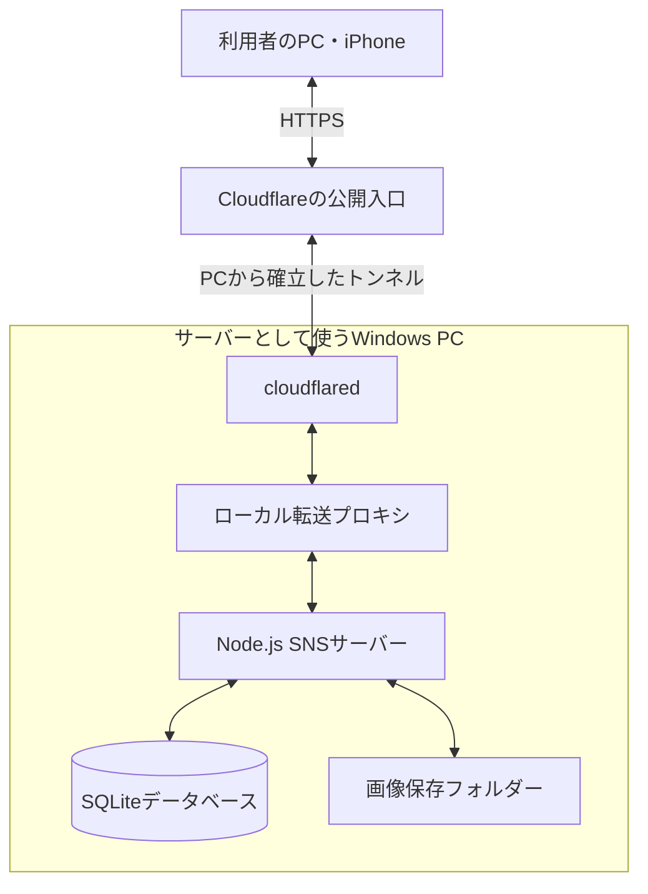

# つながり — 招待制SNSのシステム概要

文字や画像を投稿し、いいね・コメントで交流できるSNSです。PCのWebブラウザーとiPhoneから利用できます。ChatGPTのアカウントは不要です。

## システム構成

現在の試用構成では、Windows PCをサーバーとして使い、Cloudflareの一時URLを通じて社外からもアクセスします。

矢印はリクエストと応答の経路です。トンネルへの接続はPC側から開始します。

| 構成要素 | 役割 |
|---|---|
| ブラウザー・PWA | 画面の表示、投稿・画像の送信、タイムラインの閲覧 |
| Cloudflare・cloudflared | 外部からのHTTPSアクセスをPC上のSNSへ転送 |
| ローカル転送プロキシ | 起動したSNSサーバーに通信を取り次ぐ |
| Node.js SNSサーバー | 画面配信、ログイン、投稿、いいね、コメント、招待管理 |
| SQLite | アカウント、投稿本文、コメント、いいね等を保存 |
| 画像保存フォルダー | 投稿された画像ファイルを保存 |

## 投稿が表示されるまで

1. 利用者がブラウザーで本文や画像を送信する。
2. CloudflareとPC上の転送処理を経由してSNSサーバーへ届く。
3. サーバーがログイン状態と内容を確認する。
4. 本文などをSQLiteに、画像を画像保存フォルダーに保存する。
5. ブラウザーが投稿を取得し、タイムラインに表示する。

## 主な機能

- 文字投稿（最大500文字）、画像投稿（最大4枚）
- いいね、コメント、検索、トピックによる絞り込み
- 自分の投稿の削除、プロフィールの編集
- 管理者による招待コードの発行、メンバーの利用停止・再開
- 専用のログインIDとパスワードによるログイン
- iPhoneのホーム画面への追加（PWA）

リポスト・DMはありません。iPhoneではWebアプリをホーム画面に追加して利用します。App Store配布のネイティブアプリではありません。

## 利用開始の流れ

1. 運用担当者がWindows PCでSNSを起動する。
2. 最初の管理者アカウントを作成する。
3. 管理者がメンバーのログインIDを指定し、招待コードを発行する。
4. メンバーがURLを開き、指定されたIDと招待コードで登録する。
5. 次回からはIDとパスワードでログインする。

## アカウント作成画面

- ログインID欄には入力例を表示しません。管理者が指定したログインIDを入力します。
- パスワード欄の下に「12〜128文字で設定してください。」と表示します。
- パスワード条件の案内は、初回の管理者登録と招待によるアカウント作成時に表示します。
- 通常のログイン画面では、パスワード条件の案内を表示しません。

## かんたん起動（Windows・登録済みの場合）

Node.jsとcloudflaredの導入、最初の管理者登録が済んでいれば、アプリ配布版の `start-sns.cmd` をダブルクリックして起動できます。

- 初期設定コードの入力を省き、起動確認後にブラウザーを自動で開きます。
- これまでのデータフォルダーがある場所に更新ファイルを入れ、同じ場所から起動します。
- 起動した画面は開いたままにします。停止は `Ctrl+C` です。
- デスクトップにはファイル本体ではなくショートカットを置けます。
- 初回登録には従来の `start-external.ps1` を使用します。

## 試用構成の運用条件

- サーバーPCと起動用ウィンドウを動かしている間に利用できます。
- PCの停止・スリープや通信断で利用できなくなります。
- 一時URLは起動し直すと変わります。
- 同じ保存先を使えば、投稿や画像は再起動後も残ります。
- 継続運用には、固定URL、バックアップ、安定して稼働するサーバーの準備が必要です。

このページはシステム概要の資料です。アプリのソースコードや実データは含みません。
