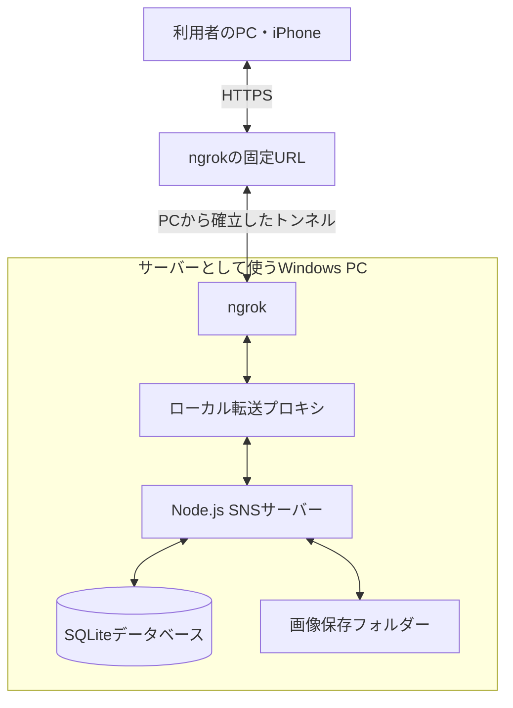

# つながり — 招待制SNSのシステム概要

文字・画像・短い動画を投稿し、いいね・コメントで交流できるSNSです。PCのWebブラウザーとiPhoneから利用できます。ChatGPTのアカウントは不要です。

## システム構成

Windows PCをサーバーとして使い、ngrokの固定URLを通じて社外からもアクセスする構成です。運用担当者がngrokの無料アカウントを作成し、割り当て済みのURLを一度設定します。独自ドメインの購入は不要です。

矢印はリクエストと応答の経路です。トンネルへの接続はPC側から開始します。

| 構成要素 | 役割 |
|---|---|
| ブラウザー・PWA | 画面の表示、投稿・画像の送信、タイムラインの閲覧 |
| ngrok | 外部からのHTTPSアクセスをPC上のSNSへ転送 |
| ローカル転送プロキシ | 起動したSNSサーバーに通信を取り次ぐ |
| Node.js SNSサーバー | 画面配信、ログイン、投稿、いいね、コメント、招待管理 |
| SQLite | アカウント、投稿本文、コメント、いいね等を保存 |
| 画像保存フォルダー | 投稿された画像ファイルを保存 |

## 投稿が表示されるまで

1. 利用者がブラウザーで本文や画像を送信する。
2. ngrokとPC上の転送処理を経由してSNSサーバーへ届く。
3. サーバーがログイン状態と内容を確認する。
4. 本文などをSQLiteに、画像を画像保存フォルダーに保存する。
5. ブラウザーが投稿を取得し、タイムラインに表示する。

## 主な機能

- 文字投稿（最大500文字）、画像投稿（最大4枚）、短いMP4動画（1本・60秒・20MB以内）
- いいね、コメント、検索、トピックによる絞り込み
- 自分の投稿の削除、プロフィールの編集
- 管理者による招待コードの発行、メンバーの利用停止・再開
- 専用のログインIDとパスワードによるログイン
- iPhoneのホーム画面への追加（PWA）

リポスト・DMはありません。iPhoneではWebアプリをホーム画面に追加して利用します。App Store配布のネイティブアプリではありません。

## 投稿文検索・絵文字・スタンプ

画面上部の「投稿文を検索」にキーワードを入力すると、本文に含まれる投稿と件数を表示します。日本語や絵文字でも検索でき、トピックや「自分の投稿」「いいねした投稿」と組み合わせられます。検索対象は投稿本文で、画像内の文字は対象外です。

投稿欄の「絵文字」から30種類を選び、本文のカーソル位置に挿入できます。「スタンプ」からは、ありがとう・おつかれさま・いいね！・おはよう・おめでとう・よろしくねの6種類を選べます。選んだスタンプは添付欄で確認してから「投稿する」で送信します。写真とスタンプは合わせて4枚まで、スタンプだけでも投稿できます。

## 共有カレンダー

PCの広い画面では右側上部に小さなカレンダーを常時表示します。予定のある日を点で示し、選択日の予定を最大3件表示します。日付を押すと大きなカレンダーでその日の予定を確認・追加できます。月送り・今日への移動・更新にも対応しています。

PCの左メニュー、スマートフォンの下部メニューからも開けます。幅の狭い画面では右側欄を非表示にして、メニューから利用します。

- 予定名、日付、開始・終了時刻、メモを登録できます。時刻は日本時間で、終日の予定にも対応しています。
- ログインしたメンバー全員が閲覧できます。新規追加は管理者のみ可能で、一般メンバーには追加ボタンを表示しません。編集・削除は登録者本人だけが行えます。更新前に一般メンバーが登録した予定も残ります。
- 予定はデータベースに保存され、同じ保存先で再起動すれば残ります。他のメンバーの変更は「再読み込み」で取得できます。
- 繰り返し予定・通知・外部カレンダー連携は含みません。

## 短い動画

投稿欄の「動画」からMP4を1本添付できます。60秒以内・20MB以内で、写真・スタンプとは別の投稿にします。動画だけの投稿も可能です。タイムラインで手動再生でき、未ログインでは取得できません。MOVなどはMP4に書き出してから投稿します。自動変換・圧縮はありません。

## ホーム画面のアプリと通知

iPhoneではSafariから「ホーム画面に追加」し、そのアイコンから開きます。iOS 16.4以降では、プロフィール →「通知設定」→「通知をオンにする」から受信を許可できます。

- ほかのメンバーの新規投稿、自分の投稿への返信、固定コメントの更新を通知します。
- 通知には本文や名前を表示せず、通知を開くとホームに移動します。
- 各端末でオン・オフとテスト通知を操作できます。
- ログアウト・ログイン期限切れ・利用停止の後は該当端末への送信を止めます。再ログイン後は通知をオンにし直します。
- サーバーPC・SNS・回線の稼働が必要です。OSや通信状況によって届かない場合があり、到着保証はありません。

通知送信はNode.js版のHTTPS構成で利用できます。App Store配布のアプリではありません。動画と通知の手順・条件は配布版の `VIDEO_NOTIFICATIONS.md` を参照してください。送信処理や権限を自動テストしていますが、実サービスを通したiPhoneへの到着・動画再生は更新後に確認してください。

## 返信コメントの削除

投稿のコメント欄で、自分が書いた返信に「削除」が表示されます。確認画面で削除すると、その返信だけが消え、コメント件数も更新されます。他の人の返信は削除できません。

## ホームの固定コメント

ホーム上部の紹介文を、管理者が編集できる固定コメント欄に変更しました。

- 管理者はホームの「固定コメントを追加」から登録し、「編集する」から変更できます。
- 1件・1000文字以内で、改行できます。ログインしたメンバー全員のホームに表示されます。
- 空欄で保存すると解除できます。未設定・解除時は一般メンバーに欄を表示しません。
- 他のメンバーの画面には、ページ再読み込みまたはホームの更新ボタンで反映されます。
- 固定コメントはデータベースに保存され、再起動後も残ります。

配布版の詳しい操作・更新手順は `ADMIN_FEATURES.md` にあります。更新時はSNSを停止し、データフォルダーをバックアップしてから上書きしてください。既存の `data-external-trial` と固定URL設定の `.sns-private` は残します。

## 利用開始の流れ

1. 運用担当者がWindows PCでSNSを起動する。
2. 最初の管理者アカウントを作成する。
3. 管理者がメンバーのログインIDを指定し、招待コードを発行する。
4. メンバーがURLを開き、指定されたIDと招待コードで登録する。
5. 次回からはIDとパスワードでログインする。

## アカウント作成画面

- ログインID欄には入力例を表示しません。管理者が指定したログインIDを入力します。
- パスワード欄の下に「12〜128文字で設定してください。」と表示します。
- パスワード条件の案内は、初回の管理者登録と招待によるアカウント作成時に表示します。
- 通常のログイン画面では、パスワード条件の案内を表示しません。

## プロフィール編集

自分のアイコン（iPhoneでは下部の「自分」）→「プロフィールを編集」から変更できます。部署の入力欄・表示はありません。

| 項目 | 内容 |
|---|---|
| アイコン | 丸く表示。画像を変更・削除できます |
| ヘッダー画像 | 横長のカバー画像を変更・削除できます |
| 表示名 | 40文字以内 |
| 自己紹介 | 160文字以内・改行対応 |
| 場所 | 任意・30文字以内 |

画像は中央で切り抜き、アイコンは正方形、ヘッダーは横3：縦1に整えます。保存したアイコンは投稿とコメントにも反映されます。投稿・コメントの名前やアイコンからプロフィールを開けます。

更新時はSNSを停止し、データフォルダーをバックアップしてから既存のアプリフォルダーに上書きしてください。Node.js版は次回起動時に必要なデータベース項目を自動追加し、既存アカウント・投稿を引き継ぎます。

## 固定URLの設定と起動（Windows・登録済みの場合）

1. 今のSNSを停止し、既存の `data-external-trial` をバックアップする。
2. 更新版を同じアプリフォルダーに上書きし、データフォルダーを残す。
3. [ngrok](https://dashboard.ngrok.com/signup)の無料アカウントを作り、[Windows用ngrok](https://ngrok.com/download/windows)を導入する。
4. 配布版の `setup-fixed-url.cmd` を開き、[Domains](https://dashboard.ngrok.com/domains)の固定URLとAuthtokenをPC上で設定する。トークンをGitHubやチャットに掲載しない。
5. `start-sns.cmd` をダブルクリックする。通信確認後にブラウザーが開く。

設定手順・無料プランの制限は配布ZIPの `FIXED_URL.md` にあります。初回の管理者登録は `HOME_SERVER.md` を参照してください。利用メンバーにngrokやChatGPTの登録は不要です。

- 同じngrokアカウント・同じドメイン設定なら、再起動してもURLは変わりません。ログイン操作でも変わりません。
- 旧URLから切り替えたときは、新URLで一度ログインし直します。既存のID・パスワード・投稿・画像・予定を引き継ぎます。
- 起動画面は開いたままにします。停止は `Ctrl+C`。PCの停止・スリープ中は接続できません。
- 固定URLの設定や接続に失敗した場合、一時URLへ切り替えず停止します。
- デスクトップからは `start-sns.cmd` のショートカットを使えます。
- 従来の `start-external.ps1` はCloudflareの一時URL用として残しています。こちらは起動し直すとURLが変わります。

## 無料プランと運用条件

2026年11月20日確認時点のngrok無料プランには、ブラウザーの案内ページ、月1GBの転送量、月20,000 HTTPリクエストの上限があります。画像閲覧や画面更新でも通信量を消費します。[公式の制限説明](https://ngrok.com/docs/pricing-limits/free-plan-limits)を確認してください。

固定URLでも、サーバーPCと回線の稼働が必要です。バックアップを取り、利用人数や画像量に応じて運用環境を選定してください。

配布版は固定URLの設定・起動に対応しています。実際の公開は、運用担当者のngrokアカウントで設定して起動した後に行われます。自動テストでは再起動時のデータ維持と認証を確認していますが、実アカウントでの外部接続・iPhone動作は設定後に確認してください。

このページはシステム概要の資料です。アプリのソースコードや実データは含みません。
